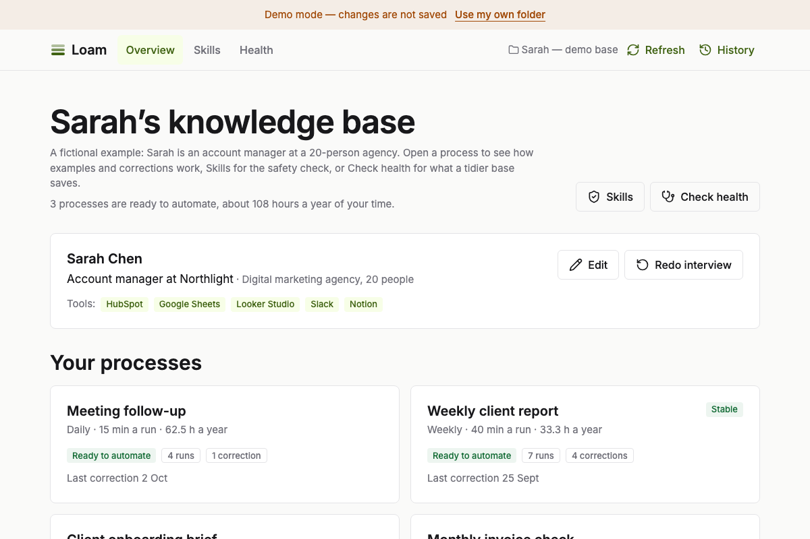

<div align="center">


# Loam

**Work context for AI agents.**<br>
Answer four short questions about your work. Get a knowledge base on your own computer that Claude, Cursor, Codex, Gemini and other AI agents can actually use.

[**Download for Claude Desktop**](https://github.com/YeremeyevTimofey/Loam/releases/latest/download/loam.mcpb) &nbsp;·&nbsp; [Try the live demo](https://loam-ai.pages.dev/app?demo=1) &nbsp;·&nbsp; [Set up another agent](https://loam-ai.pages.dev/install) &nbsp;·&nbsp; [Report a problem](https://github.com/YeremeyevTimofey/Loam/issues)

[](https://github.com/YeremeyevTimofey/Loam/actions/workflows/ci.yml)
[](https://github.com/YeremeyevTimofey/Loam/releases/latest)
[](https://www.npmjs.com/package/loam-mcp)
[](LICENSE)
[](https://github.com/YeremeyevTimofey/Loam/stargazers)
[](https://nodejs.org)
[](https://modelcontextprotocol.io)



</div>

---

## What it does

Most people have an AI assistant and still paste the same background into every prompt. Loam fixes the cause:

1. **Interviews you, through your own agent.** Your agent asks four short questions about your work, one at a time, in about four minutes. Loam never calls a model itself: no API keys.
2. **Shows what is worth automating.** Your recurring work becomes a map of processes with minutes per run and hours per year, and an honest note on what each one needs.
3. **Keeps everything as plain files you own.** A folder on your disk: your profile, your processes, examples of good results, corrections, skills.
4. **Learns from your examples and corrections.** Say "remember this correction" once and the next result is right. After a few runs a process is marked stable.
5. **Checks skills from other people before they are added.** Anything that deletes files, uses the network, sends data out, asks for passwords or tries to change how your AI behaves is refused, with no override.

No server, no account, nothing leaves your computer.

## Get started

**1. Connect your AI agent.** Loam works with any agent that can run a local [MCP](https://modelcontextprotocol.io) server. You do not need a terminal:

| Your agent | What to do |
|---|---|
| **Claude Desktop** | [**Download loam.mcpb**](https://github.com/YeremeyevTimofey/Loam/releases/latest/download/loam.mcpb) and double-click it. Choose an empty folder when Claude asks. The file downloads straight from this repository's releases, and nothing else needs installing |
| **Claude Code, Codex, Cursor, VS Code, Gemini CLI, Windsurf, Cline and others** | Send your agent this message: `Set up Loam for me. Follow the instructions at https://loam-ai.pages.dev/llms-install.md and ask me before you change anything.` It finds your folder, adds Loam to its settings and checks that it works, asking you first |
| **ChatGPT, Gemini, claude.ai** in a browser | **Copy for any chat** in the app: a process or skill as text to paste. Read-only: these chats cannot run a local server |

**2. Tell your agent:** `Run my Loam onboarding interview`. Four short questions, about four minutes. If your folder is new, your agent asks first and sets it up itself. Then ask for your work in plain words, for example `Do my weekly client report`.

**3. Optional: open the app** at [loam-ai.pages.dev/app](https://loam-ai.pages.dev/app) in Chrome or Edge to see your processes and the hours each takes, and to edit with every change shown first. (Want to look first? [Open the demo](https://loam-ai.pages.dev/app?demo=1); it works in any browser.)

<details>
<summary>Set an agent up by hand (for technical users)</summary>

You need [Node](https://nodejs.org) 22 or newer (`node --version`). Replace `<path>` with the full path of your folder.

| Agent | Command |
|---|---|
| **Claude Code** | `claude mcp add --transport stdio --scope user loam -- npx -y loam-mcp --folder <path>` |
| **Codex** | `codex mcp add loam -- npx -y loam-mcp --folder <path>` |
| **Cursor** · **VS Code (Copilot)** | One-click install links in the app |
| **Gemini CLI** · **Windsurf** · others | A few lines in the agent's MCP config |

[](https://cursor.com/install-mcp?name=loam&config=eyJjb21tYW5kIjoibnB4IiwiYXJncyI6WyIteSIsImxvYW0tbWNwIiwiLS1mb2xkZXIiLCJ%2BL0xvYW0iXX0%3D)

That button is for Mac and Linux with your folder at `~/Loam`. For another folder, or on Windows, use the app's **Connect your agent** screen, which writes the exact command or config for your agent and your folder, and the [install guide](https://loam-ai.pages.dev/install) shows them step by step. The same instructions your agent follows are in [llms-install.md](llms-install.md).

</details>

> **Chats in a browser** (ChatGPT, Gemini, claude.ai) cannot run a local server. Open a process or a skill in the app and press **Copy for any chat**: you see exactly what will be copied, tick what to include, and paste it into the chat. It is a one-way copy; the text contains your latest example and corrections, and imported skills are wrapped as data. Any agent that opens the folder can also read it: `AGENTS.md` is read natively by Codex, Cursor, Copilot and Windsurf, and Loam adds `GEMINI.md` for Gemini CLI and copies your skills to `.claude/skills` and `.agents/skills`, where Claude Code, Cursor, Codex, Gemini CLI, Copilot and others look for them.

<details>
<summary>Verify the download</summary>

Every [release](https://github.com/YeremeyevTimofey/Loam/releases) publishes `loam.mcpb.sha256` next to the file and a GitHub build attestation:

```bash
shasum -a 256 loam.mcpb          # compare with loam.mcpb.sha256
gh attestation verify loam.mcpb --repo YeremeyevTimofey/Loam
```

</details>

## See it on an example

The demo is a fictional account manager, Sarah, at a 20-person marketing agency. [Open her knowledge base](https://loam-ai.pages.dev/app?demo=1) to see:

- **5 processes** found by the interview, 3 ready to automate: about **108 hours a year**.
- A weekly report refined by **4 corrections** until it was marked *stable*.
- Starter skills, one imported skill with a safety scan and an agent review, and one skill the safety check **refused**.
- A health check: a typical task reads **5,651 tokens** in this deliberately messy sample, **2,218** after the suggested clean-up (**61% less**).

## Private and safe by design

| Claim | How it is checked |
|---|---|
| Your data never leaves your machine | The app page ships a Content-Security-Policy with `connect-src 'none'`; tests record every request; a static audit ([`scripts/check-rules.mjs`](scripts/check-rules.mjs)) finds no network calls in the app, the server or the core |
| No account, no server | The site is static files; there is no backend dependency |
| Other people's skills are checked | One scanner ([`scanner.ts`](packages/loam-core/src/scanner.ts)), shared by the app and the server, tested against [malicious skills](packages/loam-core/test/fixtures/malicious) for every red category, look-alike letters, hidden characters and more |
| A review never grants anything | The agent's verdict is information only; it is not used in any access decision |
| "Copy for any chat" is one-way | It shows the exact text first, flags anything that looks like a key or a password, wraps imported skills as data, and a static rule forbids any write in that code ([`chat-context.ts`](packages/loam-core/src/chat-context.ts)) |
| The extension only touches your folder | Paths are normalised and checked again through symlinks ([`node-store.ts`](apps/mcp-server/src/node-store.ts)); tests try `../`, absolute paths and links |

Details: [docs/ARCHITECTURE.md](docs/ARCHITECTURE.md#privacy-each-claim-and-how-it-is-checked). Found a hole in the scanner? Please read [SECURITY.md](SECURITY.md) and [report it privately](https://github.com/YeremeyevTimofey/Loam/security/advisories/new).

## Repository

| Folder | What is in it |
|---|---|
| [`apps/web/`](apps/web) | landing page, install guide, the app (React), [sample knowledge base](apps/web/src/demo-data/kb), [starter skills](apps/web/src/starter-skills) |
| [`apps/mcp-server/`](apps/mcp-server) | the MCP server, packed as `loam.mcpb` (Claude Desktop) and as the npm package [`loam-mcp`](https://www.npmjs.com/package/loam-mcp) |
| [`packages/loam-core/`](packages/loam-core) | schema, scanner, lint, skill generation: shared by the app and the server |
| [`e2e/`](e2e) · [`scripts/`](scripts) | browser tests (Chromium, Firefox, WebKit) and build tooling |
| [`docs/`](docs) | architecture, development, publishing, acceptance criteria |
| [`site.config.json`](site.config.json) | every address (domain, repository, package name) in one place |

Quick start for developers (Node 22+):

```bash
npm install
npm run dev          # landing page, install guide and app at http://localhost:5173
npm run verify       # types, tests, build, rules audit, both packages, browser tests
```

More: [development guide](docs/DEVELOPMENT.md) · [architecture](docs/ARCHITECTURE.md) · [publishing](docs/PUBLISHING.md) · [acceptance criteria](docs/acceptance.md) · [contributing](CONTRIBUTING.md).

## Help

- **Something not working, or an idea?** [Open an issue](https://github.com/YeremeyevTimofey/Loam/issues) and say which agent and which computer you use.
- **A security problem?** [Report it privately](https://github.com/YeremeyevTimofey/Loam/security/advisories/new); please do not open a public issue for something exploitable.
- **Want to contribute?** Read [CONTRIBUTING.md](CONTRIBUTING.md) first.

## License

[MIT](LICENSE). The Inter typeface is under the SIL Open Font License (`apps/web/public/fonts/OFL.txt`).
